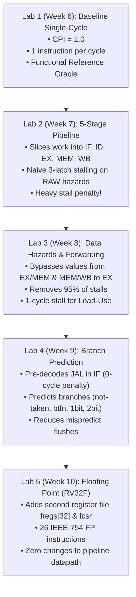

# RISC-V Simulator Labs: The Conceptual & Implementation Handbook

> **Target Audience**: A student or developer with zero prior knowledge of this repository who wants to understand what the computer architecture lab sheets are doing, why they exist, how the simulator models hardware in C, and how each lab builds progressively upon the last.

---

## Table of Contents
1. [Zero-Knowledge Primer: What is a Processor Simulator?](#1-zero-knowledge-primer-what-is-a-processor-simulator)
2. [The 5-Lab Journey: The Big Picture Roadmap](#2-the-5-lab-journey-the-big-picture-roadmap)
3. [Lab 1 (Week 6): The Baseline Single-Cycle RV32I Processor](#3-lab-1-week-6-the-baseline-single-cycle-rv32i-processor)
4. [Lab 2 (Week 7): Slicing Time — Building the 5-Stage Pipeline](#4-lab-2-week-7-slicing-time--building-the-5-stage-pipeline)
5. [Lab 3 (Week 8): Data Hazards, Forwarding & Load-Use Interlocks](#5-lab-3-week-8-data-hazards-forwarding--load-use-interlocks)
6. [Lab 4 (Week 9): Control Hazards, Branch Prediction & Pre-Decode](#6-lab-4-week-9-control-hazards-branch-prediction--pre-decode)
7. [Lab 5 (Week 10): Floating-Point Arithmetic Extension (RV32F)](#7-lab-5-week-10-floating-point-arithmetic-extension-rv32f)
8. [Codebase Map: How the C Files Map to Physical Silicon](#8-codebase-map-how-the-c-files-map-to-physical-silicon)
9. [The Golden Invariants & Mathematical Identities](#9-the-golden-invariants--mathematical-identities)

---

## 1. Zero-Knowledge Primer: What is a Processor Simulator?

### 1.1 "Software as Silicon"
When electrical engineers design a CPU (like an Intel Core i7, an Apple M-series chip, or a RISC-V processor), they do not manufacture silicon chips on day one. Fabrication costs millions of dollars. Instead, they first write software models of the processor to test its logic, measure its speed, and count its clock cycles.

This repository is **not** an operating system and **not** a hardware description file (Verilog/VHDL). It is a **cycle-accurate processor simulator written in C11**.

Every hardware component on a physical motherboard is represented by a C data structure:
- **Registers (The Scratchpad)**: An array `uint32_t regs[32]` inside a `CPUState` struct.
- **Program Counter (PC)**: A 32-bit integer `uint32_t pc` storing the memory address of the current instruction.
- **Main Memory (RAM)**: A flat array of bytes `uint8_t data[1048576]` (1 MB) inside a `Memory` struct.
- **Clock Tick**: A function call (`execute_cycle()` or `pipeline_cycle()`). Calling the function once advances time by exactly **1 clock cycle**.

```text
       PHYSICAL SILICON                         C CODE EQUIVALENT
+-------------------------------+       +-------------------------------+
|  32 Flip-Flop Registers       |  ==>  |  uint32_t regs[32];           |
|  Program Counter (PC) Wire    |  ==>  |  uint32_t pc;                 |
|  1 MB DRAM Chip               |  ==>  |  uint8_t mem_data[1048576];   |
|  ALU (Adder / Logic Unit)     |  ==>  |  alu() function in C          |
|  Clock Generator (Oscillator) |  ==>  |  Loop calling pipeline_cycle()|
+-------------------------------+       +-------------------------------+
```

### 1.2 What is RISC-V RV32I?
- **RISC**: *Reduced Instruction Set Computer*. Unlike x86 (Intel/AMD), which has thousands of complex instructions, RISC architectures provide a small, simple, modular set of operations.
- **RV32I**:
  - `RV`: RISC-V.
  - `32`: 32-bit architecture (registers and memory addresses are 32 bits wide).
  - `I`: Base Integer instruction set (arithmetic, logic, memory loads/stores, branches, jumps). Everything else (multiplication `M`, floating point `F`, vectors `V`) is an optional extension.

---

## 2. The 5-Lab Journey: The Big Picture Roadmap

The entire curriculum is designed as a progressive evolutionary chain. Each lab solves a fundamental limitation of the previous one:



### The Immutable Law of the Course
> **"Optimization changes WHEN instructions execute, never WHAT they compute."**
> 
> No matter whether you run in single-cycle mode, stalling pipeline mode, forwarding mode, or branch prediction mode, **the final register file (`x0`..`x31`) must match bit-for-bit across every single engine**. If an optimization produces a different register value, it is a bug, not an optimization.

---

## 3. Lab 1 (Week 6): The Baseline Single-Cycle RV32I Processor

### 3.1 The Problem It Solves
Before you can overlap instructions in a complex pipeline, you must have a 100% mathematically correct functional model. Lab 1 builds that model: a **Single-Cycle Processor** where each instruction executes from start to finish in a single clock cycle ($\text{CPI} = 1.000$).

This single-cycle engine serves as the **Reference Oracle** for the entire semester.

### 3.2 How It Works (The 4-Step Cycle)
Inside `core/executor.c`, the function `execute_cycle()` runs every clock tick:
1. **Fetch**: Read 4 bytes (32 bits) of machine code from simulated RAM at address `cpu->pc`.
2. **Decode**: Extract fields (opcode, destination register `rd`, source registers `rs1`, `rs2`, immediate values).
3. **Execute**: Look up the instruction handler in `core/isa_registry.c` and run it (e.g., `exec_add`: `R[rd] = R[rs1] + R[rs2]`).
4. **Update PC**: Advance `cpu->pc = cpu->next_pc` (usually `pc + 4`, or target address for jumps/taken branches).

```text
                  +-----------------------------------+
                  |         FETCH: RAM[pc]            |
                  +-----------------+-----------------+
                                    |
                                    v
                  +-----------------+-----------------+
                  |      DECODE: opcode, rd, rs       |
                  +-----------------+-----------------+
                                    |
                                    v
                  +-----------------+-----------------+
                  |      EXECUTE: ALU / Memory        |
                  +-----------------+-----------------+
                                    |
                                    v
                  +-----------------+-----------------+
                  |    COMMIT: pc = next_pc           |
                  +-----------------------------------+
```

### 3.3 Key Architectural Highlights in the Codebase
- **Strict `x0` Zero Enforcement**: In RISC-V, register `x0` is permanently wired to ground (`0`). Any write to `x0` is discarded. In `core/cpu_state.c`, `cpu_read_reg()` always returns `0` if index is `0`, and `cpu_write_reg()` silently returns without writing. This eliminates buggy checks in instruction handlers.
- **The Plugin ISA Registry (`core/isa_registry.c`)**: Instead of a giant 2,000-line `switch(opcode)` statement, every instruction registers itself into a dynamic table with its bitfield patterns and execution function pointer. Adding a new instruction in later labs requires **zero changes** to the core engine.
- **Two-Pass Assembler (`assembler/assembler.c`)**:
  - **Pass 1**: Scans assembly text line by line to map label names (e.g., `loop:`) to memory addresses.
  - **Pass 2**: Resolves forward branch/jump offsets and encodes instructions into 32-bit binary words.

---

## 4. Lab 2 (Week 7): Slicing Time — Building the 5-Stage Pipeline

### 4.1 The Problem It Solves
In a single-cycle processor, the clock cycle must be long enough for the slowest instruction (usually `lw`: Fetch $\to$ Decode $\to$ ALU $\to$ Memory Read $\to$ Register Write) to finish. While `lw` is accessing memory, the ALU and decoder sit idle.

Pipelining slices the execution of an instruction across **5 synchronous stages**:
1. **IF (Instruction Fetch)**: Pulled from memory; `pc` advances.
2. **ID (Instruction Decode & Register Read)**: Opcode decoded, registers read from register file.
3. **EX (Execute / Address Calculation)**: ALU performs operation, branches evaluated.
4. **MEM (Memory Access)**: Data memory read (`lw`) or write (`sw`).
5. **WB (Writeback)**: Result written into destination register `rd`.

Now, up to **5 different instructions are in flight at the exact same moment**:

```text
Cycle ->      1     2     3     4     5     6     7
Instruction 1: IF    ID    EX    MEM   WB
Instruction 2:       IF    ID    EX    MEM   WB
Instruction 3:             IF    ID    EX    MEM   WB
Instruction 4:                   IF    ID    EX    MEM   WB
Instruction 5:                         IF    ID    EX    MEM   WB
```

### 4.2 Hardware Latches & Preventing "Time Travel"
Stages cannot talk to each other directly in the same cycle. Instead, they write into boundary registers called **latches**:
- `IF/ID` latch: Holds fetched machine word and PC.
- `ID/EX` latch: Holds decoded registers, immediate values, control signals.
- `EX/MEM` latch: Holds ALU result, store data.
- `MEM/WB` latch: Holds memory load result or ALU result for writeback.

#### The Snapshot/Commit Pattern in C
In software, C executes sequentially. If the EX stage writes into `EX/MEM` before the MEM stage reads `EX/MEM`, MEM reads *future* data!
To model hardware registers faithfully, Lab 2 mandates the **Snapshot/Commit** pattern:
```c
CPUStatus pipeline_cycle(Pipeline *p, CPUState *cpu, Memory *mem) {
    Pipeline nx = *p;   /* Snapshot current state into 'nx' (next state) */

    /* EVERY stage reads from 'p->...' (old state) and writes to 'nx....' (next state) */
    stage_wb(p, &nx, cpu);
    stage_mem(p, &nx, mem);
    stage_ex(p, &nx);
    stage_id(p, &nx, cpu);
    stage_if(p, &nx, mem, cpu);

    *p = nx;            /* Commit: one clock edge advances all latches simultaneously */
    return cpu->status;
}
```

### 4.3 Control Signals (`pipeline/control.c`)
In hardware, the decode stage generates control wires that travel alongside the instruction like a passport:
- `reg_write`: Does this instruction write back to `rd`?
- `mem_read`: Does it read RAM?
- `mem_write`: Does it write RAM?
- `is_branch`: Is it a conditional branch?
- `is_jump`: Is it an unconditional jump (`jal`/`jalr`)?

### 4.4 Naive Stalling & Precise Exceptions
- **RAW Hazard**: If instruction 2 reads register `x1` which instruction 1 hasn't written back yet, Lab 2 solves it naively: **freeze IF and ID, and inject an empty bubble (`valid = 0`) into EX**.
- **Precise Exceptions**: If an instruction causes a memory fault or illegal instruction, the CPU must **not** halt immediately. Older instructions ahead of it in the pipeline must finish and retire first. Faults are tagged onto latches (`PF_ILLEGAL`, `PF_MEM`) and only trigger a CPU halt when they reach **WB**.

---

## 5. Lab 3 (Week 8): Data Hazards, Forwarding & Load-Use Interlocks

### 5.1 The Problem It Solves
Lab 2's naive stalling ruins performance. In back-to-back operations:
```asm
addi t0, zero, 5    # Producer: writes t0 in WB (Cycle 5)
addi t1, t0, 10     # Consumer: reads t0 in ID (Cycle 3) -> Stalls for 3 cycles!
```
The consumer waits for `t0` to reach the register file, even though the ALU finished computing `5` at the end of Cycle 3!

### 5.2 The Forwarding Unit (`pipeline/hazard.c`)
Instead of waiting for writeback, we run physical "bypass wires" directly from the pipeline latches back into the inputs of the EX stage:
1. **EX/MEM Forwarding (Distance 1, Highest Priority)**: The instruction in MEM has its computed result sitting in `ex_mem.alu_result`. We forward it straight to the ALU input.
2. **MEM/WB Forwarding (Distance 2)**: The instruction in WB has its result in `mem_wb.wb_val`. We forward it to the ALU input.

```text
               +-----------------------+
               |   EX/MEM.alu_result   |------+ (Distance 1: Newer, Priority!)
               +-----------------------+      |
               +-----------------------+      |
               |     MEM/WB.wb_val     |----+ | (Distance 2: Older)
               +-----------------------+    | |
                                            v v
      ID/EX.rs1_val --------------------> [ MUX ] ===> ALU Input A
      ID/EX.rs2_val --------------------> [ MUX ] ===> ALU Input B & Store Data
```

#### Where Forwarded Operands Must Be Used
Students often forward to ALU inputs but forget the other three places:
1. **ALU Operands** (`alu(..., o.a, o.b)`)
2. **Store Data** (`store_val = o.b` — e.g., `sw t0, 0(sp)` after `addi t0`)
3. **Branch Comparisons** (`branch_taken(..., o.a, o.b)` — e.g., `beq t0, t1, label`)
4. **JALR Target** (`(o.a + imm) & ~1u`)

### 5.3 The Load-Use Hazard (The Unavoidable 1-Cycle Stall)
Forwarding eliminates almost all stalls, **except one**:
```asm
lw   t0, 0(sp)      # Value does NOT exist until the END of MEM (Cycle 4)
addi t1, t0, 1      # Value is NEEDED at the START of EX (Cycle 4)
```
Data cannot travel backwards in time. Therefore, when a consumer in ID depends on a memory load currently in `ID/EX`, the **Hazard Detection Unit must inject exactly 1 stall cycle**.
After 1 stall, the load is in `MEM/WB`, and normal forwarding supplies the operand to EX.

---

## 6. Lab 4 (Week 9): Control Hazards, Branch Prediction & Pre-Decode

### 6.1 The Problem It Solves
In a 5-stage pipeline, the next instruction must be fetched in IF *every single cycle*. But for conditional branches (`beq`, `bne`, etc.), the condition is computed in **EX** (3 cycles later).
If the pipeline freezes and waits for EX, every branch wastes 2 cycles.
If the pipeline assumes fall-through (`not-taken`) and the branch is actually taken, the two instructions fetched behind it must be squashed (flushed), wasting 2 cycles.

### 6.2 Pre-Decode in IF: Free `jal` Jumps
For direct jumps (`jal ra, label`), the jump target is purely a function of the current PC and the 20-bit immediate in the instruction word.
Lab 4 adds a small combinational pre-decoder in the IF stage:
- If opcode is `0x6F` (`jal`), IF calculates the target address and redirects itself on the **very same cycle**.
- **Result**: `jal` costs **0 penalty cycles**! (In programs with frequent subroutine calls like `t4_calls.s`, this saves 66 cycles before any branch predictor even runs).
- Indirect jumps (`jalr`) read an integer register that IF cannot see, so `jalr` always incurs a **2-cycle penalty**.

### 6.3 Branch Predictors: Guessing Direction in IF
For conditional branches, the pipeline asks a predictor in IF: *"Taken or Not-Taken?"*
1. **Static `not-taken`**: Always predicts fall-through (`pc + 4`).
2. **Static `btfn` (Backward Taken, Forward Not-Taken)**:
   - Loop branches jump backwards (`target < pc`), so guess **Taken**.
   - If/else blocks jump forward over code (`target >= pc`), so guess **Not-Taken**.
   - Requires zero history tables, yet achieves ~79% accuracy!
3. **Dynamic `1bit` Predictor**:
   - Uses a 64-entry array indexed by `pc[7:2]`.
   - Remembers what the branch did last time ($0 = \text{Not-Taken}, 1 = \text{Taken}$).
   - Weakness: In nested loops, it mispredicts twice per loop execution (on exit, and on re-entry).
4. **Dynamic `2bit` Saturating Counter (Hysteresis)**:
   - Each of the 64 entries has a 2-bit counter with 4 states:
     - `0`: Strongly Not-Taken
     - `1`: Weakly Not-Taken *(Reset Default)*
     - `2`: Weakly Taken
     - `3`: Strongly Taken
   - Predicts Taken if counter $\ge 2$.
   - **Why it wins**: When a loop finishes, the exit branch only drops the counter from `3` to `2`. When the loop is re-entered, the counter is still $\ge 2$ and predicts Taken correctly!

```text
       Predict NOT-TAKEN                    Predict TAKEN
  [ 0: Strongly N ] <===> [ 1: Weakly N ] <===> [ 2: Weakly T ] <===> [ 3: Strongly T ]
         ^                                                                   ^
    Saturates at 0                                                      Saturates at 3
  (Does NOT wrap!)                                                    (Does NOT wrap!)
```

---

## 7. Lab 5 (Week 10): Floating-Point Arithmetic Extension (RV32F)

### 7.1 The Problem It Solves
High-performance computing requires single-precision floating-point arithmetic (IEEE 754).
The architectural objective of Lab 5 is profound:
> **Add a completely new instruction set extension (RV32F) with 32 new registers and a status register WITHOUT altering the core pipeline datapath.**

### 7.2 The New Silicon Components
1. **Floating-Point Registers (`f0` through `f31`)**:
   - Unlike integer `x0`, **`f0` is an ordinary register and can hold non-zero values**.
   - Unified register indexing: integer registers are `1..31`, floating-point registers are mapped to `32..63`.
   - Because the registers share a unified numbering space, the Lab 3 Forwarding and Hazard units automatically handle floating-point RAW dependencies!
2. **Floating-Point Control & Status Register (`fcsr`)**:
   - Bits 7:5: Rounding Mode (`frm`): `rne` (ties to even), `rtz` (toward 0), `rdn` ($-\infty$), `rup` ($+\infty$), `rmm` (ties away from 0), `dyn` (dynamic).
   - Bits 4:0: Sticky Exception Flags: `NV` (Invalid), `DZ` (Divide by Zero), `OF` (Overflow), `UF` (Underflow), `NX` (Inexact).
   - Accrues flags automatically across arithmetic operations.
3. **The 26 Instructions (Implemented in `isa/rv32f.c`)**:
   - **Bit Manipulation (No arithmetic, no rounding, no flags)**: `flw`, `fsw`, `fsgnj.s` (`fmv.s`), `fsgnjn.s` (`fneg.s`), `fsgnjx.s` (`fabs.s`), `fmv.x.w`, `fmv.w.x`, `fclass.s`.
   - **Arithmetic**: `fadd.s`, `fsub.s`, `fmul.s`, `fdiv.s`, `fsqrt.s`, and 4 Fused Multiply-Adds (`fmadd.s`, `fmsub.s`, `fnmsub.s`, `fnmadd.s`).
   - **Comparisons & Conversions**: `feq.s` (quiet), `flt.s` (signalling), `fle.s` (signalling), `fmin.s`, `fmax.s`, `fcvt.w.s`, `fcvt.wu.s`, `fcvt.s.w`, `fcvt.s.wu`.

### 7.3 Traps for the Unwary (Why RISC-V Differs from Standard C)
- **Canonical NaN**: RISC-V mandates that any invalid operation producing a NaN must return `0x7fc00000`. Native x86 FPU operations return `0xffc00000` (sign bit set). The simulator must canonicalize NaNs.
- **Ordered Zeros**: `+0.0` (`0x00000000`) and `-0.0` (`0x80000000`) compare equal in C (`==`), but `fmin.s(-0.0, +0.0)` must return `-0.0`.
- **Ties to Even**: In default rounding (`rne`), `2.5` rounds to `2`, while `3.5` rounds to `4`.
- **Conversion Saturation**: Converting out-of-range or NaN floats to integers must saturate to maximum/minimum integer bounds rather than invoking undefined C behavior.

---

## 8. Codebase Map: How the C Files Map to Physical Silicon

| C Source File | Physical Hardware Component | Lab Added | What it Does |
| :--- | :--- | :---: | :--- |
| `core/cpu_state.c/.h` | Architectural Register File | Lab 1 | Holds `regs[32]`, `pc`, machine status, diagnostic faults. |
| `core/memory.c/.h` | DRAM Main Memory | Lab 1 | 1 MB flat byte-addressed storage, little-endian word loading. |
| `core/decoder.c/.h` | Instruction Decoder Wires | Lab 1 | Extracts bit slices (`opcode`, `rd`, `rs1`, sign-extended immediates). |
| `core/isa_registry.c/.h` | Dynamic Instruction Dispatcher | Lab 1 | Lookup table mapping bitfields to function pointer handlers. |
| `core/executor.c/.h` | Single-Cycle Control Unit | Lab 1 | Runs sequential fetch-decode-execute loop (Reference Oracle). |
| `isa/rv32i_base.c/.h` | RV32I Execution Functional Units | Lab 1 | Implements ALU handlers (`add`, `sub`, `sll`, `slt`, etc.). |
| `assembler/assembler.c/.h`| Assembly Toolchain | Lab 1 | Two-pass assembler parsing labels, directives, and pseudo-ops (`la`). |
| `ui/cli_display.c/.h` | Debugger Hardware Console | Lab 1 | REPL prompt, register dumper, memory inspector. |
| `pipeline/control.c/.h` | Pipeline Control Generator | Lab 2 | Decodes control signals (`reg_write`, `mem_read`, etc.) in ID. |
| `pipeline/pipeline_state.h`| Clock Latches (Registers) | Lab 2 | Declares `IF/ID`, `ID/EX`, `EX/MEM`, `MEM/WB` structures. |
| `pipeline/hazard.c/.h` | Hazard Detection & Forwarding Unit | Labs 2-3 | Detects RAW hazards, executes 1-cycle load-use stalls, controls forwarding muxes. |
| `pipeline/branch_predictor.c/.h`| Branch Prediction Controller | Lab 4 | Predictor registry and table lookup dispatch. |
| `pipeline/bp_static.c` | Static Direction Predictors | Lab 4 | Implements `not-taken` and `btfn`. |
| `pipeline/bp_dynamic.c`| Dynamic Saturating Counters | Lab 4 | Implements `1bit` and `2bit` predictors with 64-entry tables. |
| `pipeline/pipeline.c` | 5-Stage Synchronous Datapath | Labs 2-4 | Snapshot/commit loop, stage executions, squashes, `--trace`. |
| `isa/rv32f.c` *(Lab 5)* | RV32F Floating-Point Unit | Lab 5 | 26 single-precision floating-point handlers. |

---

## 9. The Golden Invariants & Mathematical Identities

To verify that your simulator is operating with 100% cycle accuracy, verify these mathematical identities across every run:

### 1. Functional Integrity Invariant (Every Lab)
$$\text{Final Registers}_{\text{Pipeline}} \equiv \text{Final Registers}_{\text{Oracle}}$$
$$\text{Retired Instructions}_{\text{Pipeline}} \equiv \text{Cycles}_{\text{Single-Cycle Oracle}}$$

### 2. Lab 2 & Lab 3 Clock Cycle Accounting Identity
$$\text{cycles} = \text{retired} + \text{stalls} + 2 \times \text{flushes} + 4$$
- `retired`: Instructions that reach the WB stage and exit.
- `stalls`: Clock cycles where ID is held and a bubble is inserted into EX.
- `flushes`: Clock cycles lost to branch redirects (each branch flush squashes 2 instructions).
- `4`: Pipeline fill latency (it takes 4 cycles before the very first instruction reaches WB).

### 3. Lab 4 Branch Prediction Clock Cycle Accounting Identity
$$\text{cycles} = \text{retired} + 4 + 2 \times \text{redirects} + \text{stalls}$$
$$\text{redirects} = \text{mispredicts} + \text{jalr}$$
- `jal` is pre-decoded in IF and produces **0 redirects**.
- Every conditional branch mispredict causes **1 redirect** (2 squashed instructions = 2 penalty cycles).
- Every indirect jump `jalr` causes **1 redirect** (2 penalty cycles).

---

## Quick Reference Commands

```powershell
# 1. Run automated verification for Labs 1-4
python verify_all.py

# 2. Run the 12 sample test programs matching Cycles references.md
python check_sample_tests.py

# 3. Run single-cycle oracle
.\riscv_sim_base\rvsim.exe sample_tests\lab1_skeleton\s1_alu.s --batch

# 4. Run with data forwarding
.\riscv_sim_base\rvsim.exe sample_tests\lab3_hazards\h1_broad.s --pipeline-forward

# 5. Run with 2-bit branch predictor and trace
.\riscv_sim_base\rvsim.exe riscv_sim_base\tests\t1_counted_loop.s --batch --predictor 2bit --trace
```
