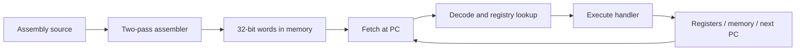

# Lab Sheets Explained: From Software to a Processor Model

No prior knowledge of this codebase is assumed. The five sheets describe one
progression: first make instruction behavior correct, then overlap instructions,
then recover the efficiency lost to dependencies and branches. Weeks 6–10 are implemented in `riscv_sim_base/`.

## 1. What is a processor simulator?

A processor reads instructions and changes registers or memory according to their
meaning. A simulator is an ordinary program that performs those changes on a
model. Here the simulator is written in C, and the programs it runs are RISC-V
assembly files ending in `.s`. The host machine does not execute those assembly
instructions directly: the simulator assembles, decodes and models them.

A **register** is a small named storage location. A **program counter**, or PC,
contains the address from which to fetch an instruction. **Memory** is a larger
array of individually addressed bytes. In RV32I, ordinary supported instructions
and integer registers are 32 bits wide. Four bytes make a 32-bit word.

Consider `addi t0, zero, 5`: read zero, add 5, and put the result in t0. A later
`add t1, t0, t0` should put 10 in t1. Register x0, whose ABI name is `zero`, always
reads as zero regardless of attempted writes.

## 2. What does “Software as Silicon” mean?

It means using software structures to represent hardware state and rules, not
turning this C program into a physical chip.

| Hardware concept | C representation in this project |
|---|---|
| Integer register file | `CPUState.regs[32]` plus read/write accessors |
| Program-counter register | `CPUState.pc` |
| RAM | `Memory.data` byte array |
| Instruction decoder | `decode_instruction` and registry lookup |
| ALU | arithmetic/logic operations in handlers or the pipeline's `alu` helper |
| Control wires | fields in `ControlSignals` |
| Clocked interstage storage | IFID, IDEX, EXMEM and MEMWB structs |
| Empty stage | a latch with valid=0 |
| Operand bypass network | comparisons and selection in `forward_operands` |
| Prediction table | a pipeline-owned `BPState.table[64]` |

A real flip-flop changes stored state at a clock edge. A C struct does not change
synchronously by itself. The simulator makes it act that way by reading the old
struct, writing a next-state struct, then committing the latter once per modeled
clock. RAM is modeled functionally, not as a bank of real memory transistors.

## 3. Week 6 / Lab 1: make one instruction correct

### Goal

Understand the original single-cycle processor before overlapping anything.
“Single-cycle” here means that one executor call completes an instruction. For
normal successful runs, cycles equal executed instructions and CPI is 1.

### The instruction's journey



The assembler translates human-readable mnemonics into binary instruction words.
The decoder recovers fields such as source registers, destination register and
immediate constant. The registry connects a recognized encoding to a C function.
Execution changes architectural state and chooses the next PC, usually PC+4.

**Semantics**, **encoding** and **execution mechanism** are different questions:
“what does add mean?”, “which bits represent add?”, and “which C operation models
it?” Keeping those questions separate makes the source easier to follow.

### What to inspect

Read `core/cpu_state.h`, `core/executor.c`, then an `exec_add` or `exec_lw` handler
in `isa/rv32i_base.c`. Run `sample1_sum_loop.s`: it prints 55 in 53 cycles. This
engine becomes the **oracle**, meaning the reference against which later engines
are compared. An oracle is useful, but it can also contain bugs; independent
provided expected outputs add a second source of evidence.

## 4. Week 7 / Lab 2: overlap five stages

### Why a pipeline?

An instruction has several kinds of work. A pipeline lets different instructions
perform different kinds at once, like workstations on an assembly line:

| Stage | Meaning | Main job |
|---|---|---|
| IF | Instruction Fetch | Read instruction word at the fetch PC |
| ID | Instruction Decode | Decode fields, generate controls, read operands |
| EX | Execute | Arithmetic, address calculation, branch/jump resolution |
| MEM | Memory | Read/write data memory |
| WB | Write Back | Finish the architectural result and retire |

```text
Clock:  1   2   3   4   5   6   7
I1:    IF  ID  EX MEM  WB
I2:        IF  ID  EX MEM  WB
I3:            IF  ID  EX MEM  WB
```

The stages contain different instructions. Data is handed to the next stage via
a latch and becomes available there on the next clock, not immediately.

### What the sheet asks you to build

Create control signals, four pipeline-latch structs and a five-stage clock.
Retain the original engine as a reference. Add valid bits so an empty slot does
nothing. Carry a fault down the pipeline instead of stopping as soon as it is
noticed. Add conservative stalling and redirects so results remain correct.

A **precise exception** means older instructions finish, the faulting instruction
is reported, and younger instructions do not change the final architectural
result. For example, fetch may already be reading zero-filled data after an exit
instruction. If ID halted on that zero word immediately, it could prevent the
older exit from finishing. Delaying the fault until WB lets age determine which
instruction actually ends the run.

### What is a bubble or a flush?

A **bubble** is an empty stage slot, represented by valid=0. It does not retire.
A `nop` is different: it is a real encoded instruction and does retire.

A **flush** discards younger instructions because their path was wrong. In the
sheet timing mode, EX can fetch the target in its redirect clock, losing one
slot. The supplied reference model restarts target fetch the next clock and
charges two cycles. Always identify the timing model before comparing counts.

## 5. Week 8 / Lab 3: dependencies and bypasses

### The problem: an instruction wants a value too soon

```asm
addi t0, zero, 5
addi t1, t0, 10
```

The second instruction must read the 5 produced by the first. In the pipeline,
it may reach ID before that value reaches the register file. This is a
**read-after-write dependency**, abbreviated RAW. If unhandled, it silently reads
an old value; the instruction meanings can be correct while program results are
wrong because their timing is wrong.

A **stall** waits for the value. This project's stall holds IF/ID, freezes fetch,
and inserts an EX bubble. Older instructions keep progressing. Forgetting any
one of the three actions can skip an instruction or repeat work incorrectly.

### Forwarding is a shortcut to an existing result

The value may already exist in an older pipeline latch even though it has not
been written to the register file. **Forwarding**, also called **bypassing**,
sends that existing result directly to the consumer's EX input.

```text
Result from instruction currently in MEM ----+
Final value from instruction currently in WB -+--> choose newest --> EX input
Operand captured earlier in ID --------------+
```

If both older instructions write the same register, the newer producer wins.
Forwarding must also feed store data, branch comparisons and jalr targets; they
consume registers just as arithmetic does. x0, unused encoding fields and empty
slots must not create fake hazards.

### Why loads still need a stall

For `lw t0, 0(gp)` followed by `addi t1, t0, 1`, the load calculates an **address**
in EX and obtains **data** at the end of MEM. The next instruction would need
that data at the beginning of EX during the same clock. A shortcut cannot deliver
a value before it exists. One stall postpones the consumer, after which MEM/WB
contains the data. The load's address must never be mistaken for its result.

### What improves?

For `micro.s`, the same five instructions take 15 sheet-stalling clocks and
9 sheet-forwarding clocks. Both give the same registers. The dependencies still
exist; forwarding changes where the consumers obtain their operands.

WAR (write-after-read) and WAW (write-after-write) are not hazards in this fixed,
in-order five-stage model because all instructions read and write in order.
More complex out-of-order or variable-latency designs need additional mechanisms.

## 6. Week 9 / Lab 4: choose a path before you know the answer

### Why prediction is needed

A conditional branch such as `bne t0, zero, loop` has two possible next addresses.
IF must select one before EX has compared the operands. A **branch predictor**
guesses direction using limited information, not the actual register values.
Correct guesses preserve overlap; incorrect ones are recovered with a flush.

The lab interface has three operations: reset initial state, predict without
changing state, and update when EX knows the outcome. A wrong-path branch
squashed before EX never becomes an actual training example.

### The four predictors

| Predictor | Intuition | Memory |
|---|---|---|
| not-taken | Keep walking forward | None |
| btfn | Backward branches usually repeat loops; forward branches usually fall through | None |
| 1bit | Guess what this table entry did last time | 64 one-bit values stored in bytes |
| 2bit | Change a confident guess only after more evidence | 64 saturating two-bit counters stored in bytes |

Two-bit **hysteresis** means resistance to changing direction after one surprise.
A taken outcome moves the counter right; a not-taken outcome moves it left:

```text
0 <--> 1 <--> 2 <--> 3
predict N     predict T
```

Movement stops at the endpoints. Wrapping 3 to 0 would turn confidence in taken
into confidence in not-taken after another taken outcome—the opposite of learning.
Counters start at 1, weakly not taken. A loop exit can reduce 3 to 2 without
making the next loop entry predict not-taken.

**Aliasing** means two branch addresses select the same entry. Here the index is
PC bits 7:2, so a separation of 256 bytes produces a collision. The table has no
labels/tags to distinguish them. Their outcomes can reinforce or disrupt each
other. The supplied adversarial sample intentionally demonstrates this.

### Direct versus indirect jumps

A direct `jal` encodes its target, so IF can follow it immediately with zero
redirect penalty. `jalr` depends on a register and is not predicted here; it
costs two redirect cycles. A **return-address stack** (RAS) could help predict
function returns, but W9 does not implement one.

Dynamic is not automatically better. BTFN has no learning delay and is fastest
in aggregate on the supplied three W9 samples; two-bit helps some patterns but
cannot represent every alternating/history-dependent behavior.

## 7. Week 10 / Lab 5: numbers with fractions

Integer registers hold whole-number bit patterns. **Floating point** represents
numbers with a sign, exponent and fraction, trading finite precision for a wide
range of magnitudes. Binary32 uses 1 sign bit, 8 exponent bits and 23 fraction
bits; normal values also have an implicit leading significand bit.

This sheet adds 26 FP instructions, FP registers, rounding rules and
exception flags. A second register file means f0 is a normal writable register,
unlike x0. Fused multiply-add needs a third source operand and rounds the entire
multiply-plus-add once, which can differ from two separately rounded operations.

A **NaN** is a bit pattern meaning “not a number”, for example the arithmetic
result of 0/0. A **canonical NaN** is the standard result bit pattern chosen for
arithmetic, 0x7fc00000 in this specification. Quiet and signalling NaNs behave
differently for flags. Raw-bit moves and sign manipulation preserve payloads;
they are not ordinary numerical calculations.

Rounding chooses a representable value when the exact result cannot be stored.
The five modes are nearest/ties-even, toward zero, down, up and nearest/ties-away.
A status register, fcsr, records rounding mode and sticky NV/DZ/OF/UF/NX flags:
invalid operation, division by zero, overflow, underflow and inexact result.
Sticky means a flag remains set until software clears it.

The f1/f2/f3 samples now run: they print 11, 12 and 1432536311, respectively.
The missing FP registers, CSR forms, numerical helpers and third-operand paths
have been recreated. A vendored software floating-point backend implements exact
rounding and flags, including the ties-away mode that ordinary host arithmetic
cannot select directly.

Flags are calculated in EX, forwarded to following FP/CSR instructions, and
committed at WB. This lets the processor see the correct older rounding/flag
state while discarding younger effects after a fault or exit. FP and integer
registers have separate dependency IDs, so f0 is forwarded like any normal
register while x0 remains constant. The existing hazard principles apply to all
three inputs of fused multiply-add.

## 8. How to judge a result

Three different questions must be answered independently:

1. **Behavior:** are registers, memory, output and status correct?
2. **Timing:** do clocks and events follow the selected pipeline rules?
3. **Explanation:** can the difference be attributed to fills, data waits and
   control redirects rather than a guessed “speedup”?

For successful runs:

$$\mathrm{CPI}=\frac{\mathrm{cycles}}{\mathrm{instructions\ retired}}.$$

“Retired” means finished in program order at WB; fetched or squashed instructions
do not count. Safe engines retire the same meaningful instruction sequence as
the single-cycle oracle. Bubbles never inflate the count, and x0 stays zero.

For normal runs without speculative terminal overlap:

$$C_{sheet}=I+S+F+4,\qquad C_{reference}=I+S+2F+4.$$

For W9:

$$\mathrm{redirects}=\mathrm{mispredicts}+\mathrm{jalr},$$

$$\mathrm{accuracy}=100\frac{\mathrm{branches}-\mathrm{mispredicts}}{\mathrm{branches}}.$$

A younger stall can overlap the final exit-drain clocks without delaying exit.
The simulator reports these events as `discarded_stalls`; subtract that overlap
when applying the equation to those tested cases. Faulted and cycle-limited runs
need not satisfy the normal-completion identity. Do not compare final PCs between
engines: the pipeline PC is ahead because it points to speculative fetch work.

The next useful step is [the tutorial](tutorial.md): run a sample, read the status
and summary, compare registers, then inspect a short clock trace.
