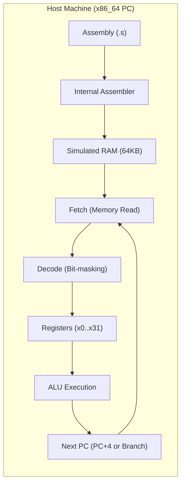

# Comprehensive Guide: The RV32I Processor Simulator (Weeks 6–10)

> **Audience & Purpose:** This document explains the complete progression of the RISC-V processor simulator from first principles. No prior knowledge of this codebase is assumed. It covers:
> 1. What was asked in each lab sheet (Weeks 6 to 10).
> 2. How the simulator looked **before vs. after** each lab sheet.
> 3. Which files were created or modified.
> 4. Detailed architectural implementation mechanics.
> 5. Exact testing procedures, execution commands, and expected outputs.
> 6. Ready-to-use tutorials and debugging workflows.

---

## Table of Contents
1. [Foundational Concepts: What is a Processor Simulator?](#1-foundational-concepts-what-is-a-processor-simulator)
2. [The "Software as Silicon" Architecture](#2-the-software-as-silicon-architecture)
3. [Lab 1 / Week 6: Single-Cycle RV32I Base Simulator](#3-lab-1--week-6-single-cycle-rv32i-base-simulator)
4. [Lab 2 / Week 7: Building the 5-Stage Classic Pipeline](#4-lab-2--week-7-building-the-5-stage-classic-pipeline)
5. [Lab 3 / Week 8: Data Hazards, Stalling, and Forwarding Bypasses](#5-lab-3--week-8-data-hazards-stalling-and-forwarding-bypasses)
6. [Lab 4 / Week 9: Control Hazards and Branch Prediction](#6-lab-4--week-9-control-hazards-and-branch-prediction)
7. [Lab 5 / Week 10: Floating-Point Extension (RV32F)](#7-lab-5--week-10-floating-point-extension-rv32f)
8. [Master Verification & Testing Tutorial](#8-master-verification--testing-tutorial)
9. [Mathematical Model & CPI Accounting](#9-mathematical-model--cpi-accounting)

---

## 1. Foundational Concepts: What is a Processor Simulator?

A physical processor (CPU) reads instructions from silicon memory, manipulates tiny transistor-based memory cells called **registers**, executes operations on an **Arithmetic Logic Unit (ALU)**, and writes values back to memory or registers.

A **processor simulator** is a software program (here written in C99/C11) that faithfully recreates the behavior and internal state of a physical CPU. The host machine (your PC/laptop running x86_64 Windows or Linux) does **not** run the RISC-V machine instructions directly. Instead:
1. The simulator reads RISC-V assembly source files (`.s`).
2. An integrated two-pass assembler converts assembly text into 32-bit RISC-V machine words.
3. The simulator loads those words into an array representing main memory.
4. A software loop mimics the CPU clock cycles, stepping through instruction fetch, decode, and execution.

### Architectural State of RV32I
- **General-Purpose Registers (`x0` – `x31`):** Thirty-two 32-bit registers. Register `x0` (`zero`) is hardwired to `0x00000000`. Any write to `x0` is discarded, and any read from `x0` returns 0.
- **Program Counter (`pc`):** A 32-bit register holding the memory address of the current instruction.
- **Main Memory:** A byte-addressable array of memory (`0x00000000` to `0x00010000`, 64 KB). RISC-V is **little-endian**: the least significant byte is stored at the lowest address.



---

## 2. The "Software as Silicon" Architecture

Every hardware unit in a physical RISC-V core has a direct C counterpart in this codebase:

| Hardware Processor Concept | C Representation in Codebase | Location in Code |
|:---|:---|:---|
| **Register File** (`x0`–`x31`) | `uint32_t regs[32]` in `CPUState` | [core/cpu_state.h](file:///s:/BITSH/3-1/Comp%20Arch/Lab%20Assignment/riscv_sim_base/core/cpu_state.h) |
| **Architectural Zero Register** | Hardcoded checks: writes ignored, reads return 0 | [core/cpu_state.c](file:///s:/BITSH/3-1/Comp%20Arch/Lab%20Assignment/riscv_sim_base/core/cpu_state.c) |
| **Program Counter (`pc`)** | `uint32_t pc`, `uint32_t next_pc` in `CPUState` | [core/cpu_state.h](file:///s:/BITSH/3-1/Comp%20Arch/Lab%20Assignment/riscv_sim_base/core/cpu_state.h) |
| **Main Memory (RAM)** | `uint8_t data[MEM_SIZE]` with little-endian shifts | [core/memory.c](file:///s:/BITSH/3-1/Comp%20Arch/Lab%20Assignment/riscv_sim_base/core/memory.c) |
| **Instruction Decoder** | Opcode/Funct3/Funct7 masking and extraction | [core/decoder.c](file:///s:/BITSH/3-1/Comp%20Arch/Lab%20Assignment/riscv_sim_base/core/decoder.c) |
| **Control Logic** | Function pointers in dispatch table (`InstructionHandler`) | [core/isa_registry.c](file:///s:/BITSH/3-1/Comp%20Arch/Lab%20Assignment/riscv_sim_base/core/isa_registry.c) |
| **ALU & Execution Units** | C handler functions (`exec_add`, `exec_sub`, etc.) | [isa/rv32i_base.c](file:///s:/BITSH/3-1/Comp%20Arch/Lab%20Assignment/riscv_sim_base/isa/rv32i_base.c) |
| **Pipeline Registers (Latches)** | Structs: `IFID`, `IDEX`, `EXMEM`, `MEMWB` | [pipeline/pipeline_state.h](file:///s:/BITSH/3-1/Comp%20Arch/Lab%20Assignment/riscv_sim_base/pipeline/pipeline_state.h) |
| **Control Signals Bus** | `ControlSignals` struct carrying control lines | [pipeline/control.h](file:///s:/BITSH/3-1/Comp%20Arch/Lab%20Assignment/riscv_sim_base/pipeline/control.h) |
| **Hazard Detection Unit** | `hazard_check()` stall logic | [pipeline/hazard.c](file:///s:/BITSH/3-1/Comp%20Arch/Lab%20Assignment/riscv_sim_base/pipeline/hazard.c) |
| **Forwarding Multiplexers** | `forward_operands()` bypass logic | [pipeline/hazard.c](file:///s:/BITSH/3-1/Comp%20Arch/Lab%20Assignment/riscv_sim_base/pipeline/hazard.c) |
| **Branch Predictor Table** | `BPState.table[64]` 1-bit / 2-bit branch history | [pipeline/branch_predictor.c](file:///s:/BITSH/3-1/Comp%20Arch/Lab%20Assignment/riscv_sim_base/pipeline/branch_predictor.c) |

---

## 3. Lab 1 / Week 6: Single-Cycle RV32I Base Simulator

### What Was Said in the Lab Sheet
Week 6 establishes the reference engine. In a single-cycle implementation, **each instruction completes in exactly 1 clock cycle**. The clock period is long enough to permit:
1. Fetching the instruction from memory.
2. Decoding the instruction format (R, I, S, B, U, J-type).
3. Reading register operands.
4. Computing the ALU result or memory effective address.
5. Reading or writing memory.
6. Writing back to the destination register.

CPI (*Cycles Per Instruction*) is identically **1.0**.

### Before vs. After
- **Before:** A student starts with the base framework specification.
- **After:** A fully functioning single-cycle execution loop in `core/executor.c`:
```c
CPUStatus execute_cycle(CPUState *cpu, Memory *mem) {
    uint32_t raw_instr;
    memory_read_word(mem, cpu->pc, &raw_instr);      // 1. IF
    DecodedInstruction instr;
    const InstructionHandler *handler;
    decode_instruction(raw_instr, &instr, &handler);  // 2. ID
    cpu->next_pc = cpu->pc + 4;                       // Default sequential PC
    handler->execute(cpu, mem, &instr);               // 3. EX + MEM + WB
    cpu->pc = cpu->next_pc;                           // Commit PC
    cpu->cycle_count++;                               // 1 cycle per instruction
    cpu->instructions_retired++;
    return cpu->status;
}
```

### Files Involved
- [core/cpu_state.c](file:///s:/BITSH/3-1/Comp%20Arch/Lab%20Assignment/riscv_sim_base/core/cpu_state.c) / [core/cpu_state.h](file:///s:/BITSH/3-1/Comp%20Arch/Lab%20Assignment/riscv_sim_base/core/cpu_state.h): Register file and PC management.
- [core/memory.c](file:///s:/BITSH/3-1/Comp%20Arch/Lab%20Assignment/riscv_sim_base/core/memory.c) / [core/memory.h](file:///s:/BITSH/3-1/Comp%20Arch/Lab%20Assignment/riscv_sim_base/core/memory.h): 64KB RAM with little-endian byte ordering.
- [core/decoder.c](file:///s:/BITSH/3-1/Comp%20Arch/Lab%20Assignment/riscv_sim_base/core/decoder.c) / [core/decoder.h](file:///s:/BITSH/3-1/Comp%20Arch/Lab%20Assignment/riscv_sim_base/core/decoder.h): Bit extraction for `opcode`, `rd`, `rs1`, `rs2`, `funct3`, `funct7`, and immediate decoding (I, S, B, U, J types).
- [core/isa_registry.c](file:///s:/BITSH/3-1/Comp%20Arch/Lab%20Assignment/riscv_sim_base/core/isa_registry.c): Hash/lookup table mapping 32-bit opcode patterns to instruction handlers.
- [isa/rv32i_base.c](file:///s:/BITSH/3-1/Comp%20Arch/Lab%20Assignment/riscv_sim_base/isa/rv32i_base.c): Implementations of standard RV32I instructions (`add`, `sub`, `and`, `or`, `xor`, `sll`, `srl`, `sra`, `slt`, `sltu`, `addi`, `lw`, `sw`, `beq`, `bne`, `blt`, `bge`, `jal`, `jalr`, `lui`, `auipc`, `ecall`).
- [assembler/assembler.c](file:///s:/BITSH/3-1/Comp%20Arch/Lab%20Assignment/riscv_sim_base/assembler/assembler.c): Parses assembly files, handles labels, directives (`.word`, `.text`, `.data`), and pseudo-instructions (`li`, `la`, `nop`, `mv`, `j`).

### How to Test Week 6
Run the basic sample programs in single-cycle mode:
```bash
./rvsim tests/sample1_sum_loop.s --single-cycle
```
**Expected Output:**
```
assembled 'tests/sample1_sum_loop.s' ok. entry point = 0x00000000
55
---------------------------- registers ----------------------------
x10/a0  =0x00000037  (decimal 55)
pc = 0x00000038
status = ECALL_EXIT   cycles = 53
```

---

## 4. Lab 2 / Week 7: Building the 5-Stage Classic Pipeline

### What Was Said in the Lab Sheet
While single-cycle execution is simple, its clock cycle must accommodate the slowest possible instruction (e.g., `lw`). In modern CPUs, instruction execution is divided across an assembly line of 5 balanced stages:
1. **IF (Instruction Fetch):** Fetch instruction word at `PC`; update `PC = PC + 4`.
2. **ID (Instruction Decode):** Decode opcode, generate control signals, read operands from register file.
3. **EX (Execute):** ALU computes arithmetic result, effective memory address, or evaluates branch conditions.
4. **MEM (Memory Access):** Read from or write to data memory for load/store instructions.
5. **WB (Write-Back):** Write result back into the register file.

```
Clock Cycle:   1    2    3    4    5    6    7
Instr 1:      [IF] [ID] [EX] [MEM][WB]
Instr 2:           [IF] [ID] [EX] [MEM][WB]
Instr 3:                [IF] [ID] [EX] [MEM][WB]
```

### Before vs. After
- **Before (Week 6):** Only `execute_cycle()` exists in `core/executor.c`. All stages happen atomically inside one function call.
- **After (Week 7):** A new module `pipeline/` is added. A `Pipeline` struct contains 4 inter-stage latches (`IFID`, `IDEX`, `EXMEM`, `MEMWB`).
  - **The Two-Phase Clock Rule:** To avoid race conditions, each stage reads from the *current* latch and writes into a *next* latch (`pipe->next`). At the end of the cycle, `pipe->current = pipe->next` commits the tick.
  - **Bubbles (`valid = 0`):** Pipeline registers include a `valid` bit. Empty stages or flushed instructions have `valid = 0` and perform no state updates.
  - **Flushes on Control Hazards:** When a branch is taken or jump executes in EX, instructions fetched in IF and ID are on the wrong path and must be squashed (`pipe->next.ifid.valid = 0;`).

### Files Created/Modified
- [pipeline/control.h](file:///s:/BITSH/3-1/Comp%20Arch/Lab%20Assignment/riscv_sim_base/pipeline/control.h) & [pipeline/control.c](file:///s:/BITSH/3-1/Comp%20Arch/Lab%20Assignment/riscv_sim_base/pipeline/control.c):
  - Defines `ControlSignals`: `reg_write`, `mem_read`, `mem_write`, `mem_to_reg`, `alu_src`, `alu_op`, `branch`, `jump`.
  - Implements `control_decode()` to generate these signals during the ID stage.
- [pipeline/pipeline_state.h](file:///s:/BITSH/3-1/Comp%20Arch/Lab%20Assignment/riscv_sim_base/pipeline/pipeline_state.h):
  - Defines latch structures: `IFID`, `IDEX`, `EXMEM`, `MEMWB`, and the top-level `Pipeline` state.
- [pipeline/pipeline.c](file:///s:/BITSH/3-1/Comp%20Arch/Lab%20Assignment/riscv_sim_base/pipeline/pipeline.c):
  - Implements `stage_fetch()`, `stage_decode()`, `stage_execute()`, `stage_memory()`, `stage_writeback()`.
  - Implements `pipeline_step()` executing the stages in reverse or snapshot/commit order: **WB $\to$ MEM $\to$ EX $\to$ ID $\to$ IF**.
- [main.c](file:///s:/BITSH/3-1/Comp%20Arch/Lab%20Assignment/riscv_sim_base/main.c):
  - Added CLI flag `--pipeline` to run the 5-stage pipeline engine.

### How to Test Week 7
Run a clean program without data hazards (or with independent instructions):
```bash
./rvsim tests/given/lab2_pipeline/p1_broad.s --pipeline
```
**Expected Output:**
- Cycle count matches $I + 4 + \text{flushes}$ (pipeline fills in 4 initial cycles).

---

## 5. Lab 3 / Week 8: Data Hazards, Stalling, and Forwarding Bypasses

### What Was Said in the Lab Sheet
When instructions overlap, hazards arise. The most prominent is the **RAW (Read-After-Write)** data dependency:
```asm
addi t0, zero, 5    # Producer: writes t0 in WB (Cycle 5)
addi t1, t0, 10     # Consumer: reads t0 in ID (Cycle 2!)
```
The consumer reaches ID **three cycles before** the producer writes the value into the register file. If unhandled, the consumer reads stale data, causing silent corruption!

### Before vs. After
- **Before (Week 7):** The pipeline would incorrectly read stale registers if dependent instructions were spaced closer than 3 instructions apart.
- **After (Week 8):**
  1. **Hazard Detection (Stalling):** The ID stage checks if source registers `rs1` or `rs2` match destination registers `rd` in `ID/EX`, `EX/MEM`, or `MEM/WB`.
     - When a hazard is detected, a **stall** performs 3 synchronized actions:
       1. Freeze the `PC` (do not advance).
       2. Freeze the `IF/ID` latch (hold the consumer in ID).
       3. Inject a **bubble** into `ID/EX` (`valid = 0`, no-op in EX).
  2. **Forwarding Unit (Bypassing):** Why wait until WB when the ALU result is already available at the end of EX or MEM?
     - Bypasses route the latest value directly from `EX/MEM` or `MEM/WB` into the ALU inputs of EX!
     - Priority rule: **EX/MEM forwarding takes precedence over MEM/WB forwarding** (newer producer wins).
     - Register `x0` is exempt from forwarding (never forward to/from zero).
  3. **Load-Use Stall (Unavoidable):**
     ```asm
     lw t0, 0(gp)       # Data only available at END of MEM stage
     addi t1, t0, 1     # Needs data at START of EX stage
     ```
     Time travel is impossible. When a load is immediately followed by a dependent instruction, the pipeline **must stall for 1 cycle**, after which forwarding can deliver the value from `MEM/WB` to EX.

```
Without Forwarding (Stalls Only):
addi t0: [IF][ID][EX][MEM][WB]
addi t1:     [IF][--][-- ][ID][EX][MEM][WB]  (3 stalls)

With Forwarding:
addi t0: [IF][ID][EX ][MEM][WB]
                   \___
addi t1:     [IF][ID ][EX ][MEM][WB]         (0 stalls!)
```

### Files Created/Modified
- [pipeline/hazard.h](file:///s:/BITSH/3-1/Comp%20Arch/Lab%20Assignment/riscv_sim_base/pipeline/hazard.h):
  - Defines `HazardVerdict` (`HAZARD_NONE`, `HAZARD_STALL`), `Operands` structure, and forwarding select codes (`FWD_NONE`, `FWD_EXMEM`, `FWD_MEMWB`).
- [pipeline/hazard.c](file:///s:/BITSH/3-1/Comp%20Arch/Lab%20Assignment/riscv_sim_base/pipeline/hazard.c):
  - `hazard_check()`: Detects load-use dependencies and stall conditions.
  - `forward_operands()`: Inspects `EX/MEM` and `MEM/WB` registers, compares with `ID/EX.rs1` and `ID/EX.rs2`, and selects forwarded data operands.
- [pipeline/pipeline.c](file:///s:/BITSH/3-1/Comp%20Arch/Lab%20Assignment/riscv_sim_base/pipeline/pipeline.c):
  - Hooked `hazard_check()` into decode stage.
  - Hooked `forward_operands()` into execute stage.
- [main.c](file:///s:/BITSH/3-1/Comp%20Arch/Lab%20Assignment/riscv_sim_base/main.c):
  - Added `--hazard <none|stall|forward>` and `--pipeline-forward` CLI switches.

### How to Test Week 8
Run the tight dependency micro-test:
```bash
./rvsim tests/micro.s --pipeline-forward
```
**Comparison:**
- Under `--hazard stall`: takes **15 cycles** (many bubbles inserted).
- Under `--hazard forward`: takes only **9 cycles**!

---

## 6. Lab 4 / Week 9: Control Hazards and Branch Prediction

### What Was Said in the Lab Sheet
In a pipelined CPU, conditional branches (`beq`, `bne`, etc.) are resolved in the **EX stage**. But the IF stage must fetch an instruction **every single cycle**. What should IF fetch on the cycle after a branch?
- If it waits until EX completes, 2 cycles are wasted on every single branch!
- Solution: **Branch Prediction**. IF guesses the outcome and target immediately.
  - If guess is **correct**: 0 penalty cycles! Execution proceeds at full speed.
  - If guess is **wrong**: EX detects the misprediction, flushes the 2 speculative instructions in IF and ID, and redirects fetch to the true target (2 penalty cycles).

### Before vs. After
- **Before (Week 8):** Defaulted to always assuming branch not taken (or stalling), suffering heavy misprediction penalties on loops.
- **After (Week 9):** Implemented four distinct branch prediction algorithms:
  1. **`not-taken` (Static):** Always predicts next PC = PC + 4.
  2. **`btfn` (Backward Taken, Forward Not-Taken - Static):**
     - Backward branches (target < PC, typical of loops) $\to$ Predict **Taken**.
     - Forward branches (target $\ge$ PC, typical of if-else skips) $\to$ Predict **Not-Taken**.
  3. **`1bit` (Dynamic):** A 64-entry table indexed by `(PC >> 2) & 0x3F`. Remembers the last outcome (1 bit: Taken or Not-Taken).
  4. **`2bit` (Dynamic Saturating Counter):**
     - 4 states: `0` (Strongly Not-Taken), `1` (Weakly Not-Taken), `2` (Weakly Taken), `3` (Strongly Taken).
     - **Hysteresis:** A loop that exits once does not immediately flip the predictor to "Not Taken" for the next time the loop begins.

```text
2-bit Saturating Counter State Diagram:
      Taken            Taken            Taken
   +--------+       +--------+       +--------+
   |        v       |        v       |        v
 [ 0: SNT ] <---- [ 1: WNT ] <---- [ 2: WT  ] <---- [ 3: ST  ]
            Not-T            Not-T            Not-T
   <--- Predict Not-Taken --->   <------ Predict Taken ------>
```

### Files Created/Modified
- [pipeline/branch_predictor.h](file:///s:/BITSH/3-1/Comp%20Arch/Lab%20Assignment/riscv_sim_base/pipeline/branch_predictor.h) & [pipeline/branch_predictor.c](file:///s:/BITSH/3-1/Comp%20Arch/Lab%20Assignment/riscv_sim_base/pipeline/branch_predictor.c):
  - Defines `BranchPredictor` interface (`predict`, `update`, `reset`).
  - Implements the 64-entry prediction table `BPState.table[64]`.
- [pipeline/bp_static.c](file:///s:/BITSH/3-1/Comp%20Arch/Lab%20Assignment/riscv_sim_base/pipeline/bp_static.c):
  - Implements `predict_not_taken()` and `predict_btfn()`.
- [pipeline/bp_dynamic.c](file:///s:/BITSH/3-1/Comp%20Arch/Lab%20Assignment/riscv_sim_base/pipeline/bp_dynamic.c):
  - Implements `predict_1bit()`, `update_1bit()`.
  - Implements `predict_2bit()`, `update_2bit()`.
- [pipeline/pipeline.c](file:///s:/BITSH/3-1/Comp%20Arch/Lab%20Assignment/riscv_sim_base/pipeline/pipeline.c):
  - In IF stage: pre-decodes branch opcode and consults `bp->predict()`.
  - In EX stage: evaluates real branch condition and calls `bp->update()`. If real outcome $\ne$ predicted outcome, flushes younger instructions and increments `mispredict_count`.

### How to Test Week 9
Run pattern branch tests with different predictors:
```bash
./rvsim sample_tests/lab4_branch/b1_patterns.s --predictor not-taken
./rvsim sample_tests/lab4_branch/b1_patterns.s --predictor btfn
./rvsim sample_tests/lab4_branch/b1_patterns.s --predictor 1bit
./rvsim sample_tests/lab4_branch/b1_patterns.s --predictor 2bit
```
Run the automated verification suite:
```bash
make test
```
**Expected Output:**
```
PASS: 747 checks; W6-W9 goldens, counters, full architectural state, faults, limits, traces
```

---

## 7. Lab 5 / Week 10: Floating-Point Extension (RV32F)

### What Was Said in the Lab Sheet
Week 10 introduces the standard **RV32F single-precision floating-point extension** (IEEE 754-2008). 

Crucially, **the pipeline structure does not need to change**: floating-point support is integrated cleanly through the modular `isa_registry` and decoding architecture.

### Architectural Requirements of RV32F
1. **Independent Floating-Point Register File (`f0` – `f31`):**
   - Thirty-two 32-bit floating-point registers.
   - **Unlike integer `x0`, `f0` is a regular, writable register!**
2. **Floating-Point Control & Status Register (`fcsr`):**
   - Holds dynamic rounding modes (`frm`, bits 7:5).
   - Accrues sticky exception flags (`fflags`, bits 4:0: `NV` Invalid, `DZ` Divide by Zero, `OF` Overflow, `UF` Underflow, `NX` Inexact).
3. **Three Source Operands (`rs1`, `rs2`, `rs3`):**
   - Required for Fused Multiply-Add instructions (`fmadd.s`, `fmsub.s`, `fnmsub.s`, `fnmadd.s`):
     $$f[rd] = \text{round}(f[rs1] \times f[rs2] \pm f[rs3])$$
4. **26 New Instructions to Implement:**
   - **Bit Manipulations / Moves (Task 1):** `flw`, `fsw`, `fsgnj.s`, `fsgnjn.s`, `fsgnjx.s`, `fmv.x.w`, `fmv.w.x`, `fclass.s`.
   - **Arithmetic (Task 2):** `fadd.s`, `fsub.s`, `fmul.s`, `fdiv.s`, `fsqrt.s`, `fmadd.s`, `fmsub.s`, `fnmsub.s`, `fnmadd.s`.
   - **Comparisons & Conversions (Task 3):** `feq.s`, `flt.s`, `fle.s`, `fmin.s`, `fmax.s`, `fcvt.w.s`, `fcvt.wu.s`, `fcvt.s.w`, `fcvt.s.wu`.
   - **Status Flags & CSR (Task 4):** Accruing sticky flags into `fcsr`.

### Implementation Status
> [!NOTE]
> As verified across the codebase, **Week 10 (RV32F) is not yet implemented** in `riscv_sim_base/`. Running `f1_broad.s` returns `unknown instruction 'flw'`.
> All test fixtures and expected files for Lab 5 are available in `sample_tests/lab5_fp/` for when RV32F is implemented.

---

## 8. Master Verification & Testing Tutorial

Follow these concrete commands to verify every feature of your simulator:

### 1. Build the Entire Codebase
Inside your WSL or Linux terminal:
```bash
cd riscv_sim_base
make clean
make
```

### 2. Test Single-Cycle (Week 6)
```bash
./rvsim tests/sample1_sum_loop.s --single-cycle
```
- **Check:** Output prints `55`, `t1` register contains `0x00000037`, `cycles = 53`.

### 3. Test Pipelining Without Hazards (Week 7)
```bash
./rvsim sample_tests/lab2_pipeline/p1_broad.s --pipeline
```
- **Check:** Register values match single-cycle execution exactly.

### 4. Test Data Hazards & Forwarding (Week 8)
Compare stall performance vs forwarding performance on `h1_broad.s`:
```bash
# Stalling only:
./rvsim sample_tests/lab3_hazards/h1_broad.s --hazard stall

# With full forwarding bypasses:
./rvsim sample_tests/lab3_hazards/h1_broad.s --hazard forward
```
- **Check:** Forwarding completes in significantly fewer cycles while producing identical final register states.

### 5. Test Branch Prediction (Week 9)
Compare predictor strategies on branch patterns:
```bash
./rvsim sample_tests/lab4_branch/b1_patterns.s --predictor not-taken
./rvsim sample_tests/lab4_branch/b1_patterns.s --predictor btfn
./rvsim sample_tests/lab4_branch/b1_patterns.s --predictor 1bit
./rvsim sample_tests/lab4_branch/b1_patterns.s --predictor 2bit
```
- **Check:** 2-bit counter and BTFN achieve higher prediction rates and lower overall cycle counts on loop benchmarks.

### 6. Run the Full Automated Test Suite (747 Assertions)
```bash
make test
```
- Runs `tests/predictor_checks` and `python3 tests/run_tests.py`.
- **Expected result:** `PASS: 747 checks; W6-W9 goldens, counters, full architectural state, faults, limits, traces`.

---

## 9. Mathematical Model & CPI Accounting

When analyzing simulator reports, use these exact formulas to audit cycle counts:

### 1. Cycles Per Instruction (CPI)
$$\mathrm{CPI} = \frac{\mathrm{Total\ Cycles}}{\mathrm{Instructions\ Retired}}$$
- **Ideal Single-Cycle:** $\mathrm{CPI} = 1.0$
- **Ideal Pipeline:** Approaches $\mathrm{CPI} \approx 1.0$ on long, independent instruction sequences.

### 2. Total Pipelined Execution Cycles
$$C = I + S + (\text{penalty} \times F) + 4$$
Where:
- $I$ = Number of retired instructions.
- $S$ = Data hazard stalls (e.g., load-use dependencies).
- $F$ = Control hazard flushes (branch mispredictions + `jalr` indirect jumps).
- $\text{penalty}$ = **1 cycle** (Sheet timing model) or **2 cycles** (Course reference timing model).
- $4$ = Initial pipeline ramp-up cycles (filling the 5 stages).

### 3. Branch Prediction Accuracy
$$\mathrm{Accuracy} = 100 \times \left( \frac{\mathrm{Total\ Branches} - \mathrm{Mispredictions}}{\mathrm{Total\ Branches}} \right) \%$$
